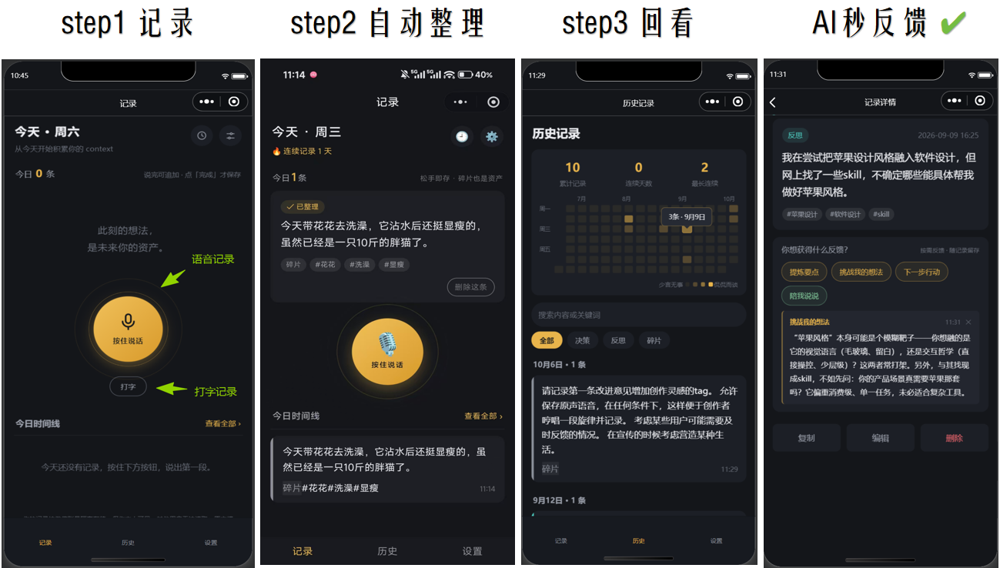
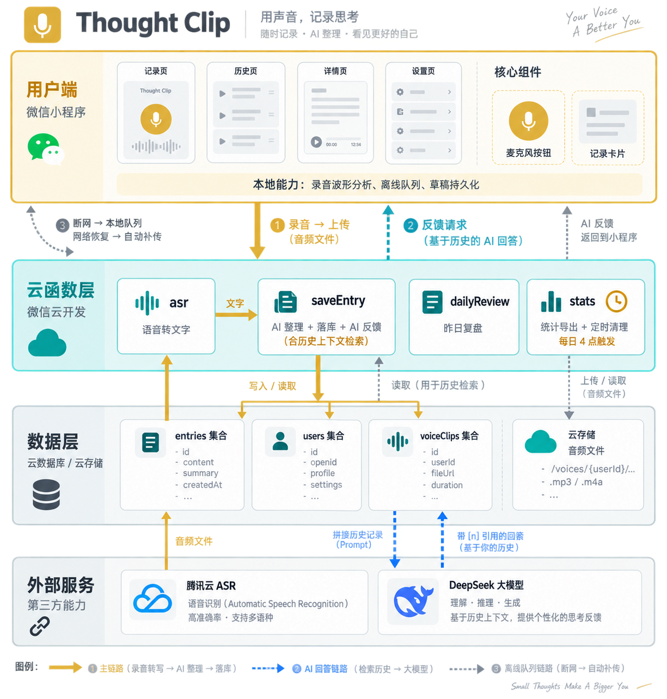

# Thought Clip

一个低摩擦的微信小程序记录工具：按住说话、松手即存，AI 帮忙整理成结构化笔记，长期积累成自己的个人 context 资产。

## 功能

- **贴纸记录**：按住说话松手即转文字，可继续追加语音/文字段、长按拖动排序、逐段点按修改；录音实时波形、30 秒上限预警（长话用追加分段表达）；录音中上滑直接存为声音灵感、下滑删除；断网自动暂存补传
- **声音灵感**：录完第一段语音可一键转存——保留原声 + 48 档幅度图 + 标题，专为旋律与哼唱设计；卡片内直接回听，可导出 wav
- **AI 整理**：清理语气词、自动分类（决策/反思/碎片）、抽关键词；也可不使用 AI 直接存原文
- **AI 反馈**：对任意记录按需获取——提炼要点 / 挑战我的想法 / 下一步行动 / 陪我说说，篇幅上限 250 字，反馈随记录留存、可删除重生成，**支持多轮追问**（首轮定话题，之后直接输入继续对话）；可开启「历史上下文检索」：反馈自动参考相关历史记录（一次最多 30 条），回答带 [n] 引用，来源以「参考贴纸 [n]」标注、可点击溯源
- **即时反馈**：保存时的落袋动效与计数滚动；连续天数、累计条数等里程碑的纪念卡庆祝
- **昨日复盘**：打开时回顾昨日要点（无 AI 时为统计摘要），当天关闭不再打扰
- **历史与资产**：全文搜索、类型筛选、近 15 周热力图（带月份/周几标注，轻点色块看当日条数）与连续统计；长按卡片快捷删除（进回收站）；Markdown 一键导出；识别失败语音暂存 7 天，可选长期保留原声；删除记录进入回收站，3 天内可还原

## 界面展示



## 迭代记录

### 2026-10-26

- **已删记录"还魂"修复**：弱网下云端实际已保存但客户端误判失败，本地离线队列留有副本；用户彻底删除该记录后幂等键失灵（它只认还存在的记录），数天后补传把副本当新记录重新落库。现彻底删除与清空全部时按幂等键同步剔除本地队列同源副本；普通删除（进回收站）天然安全，补传会命中带删除标记的记录，无需处理

### 2026-10-22

- **反馈多轮对话**：点类别开启话题，之后直接追问（裸文本即提示词），AI 结合整段对话作答；每类别唯一一串对话，芯片即查看/开启入口；思考动效与追问输入置顶，历史在限高滑窗内滚动、新回复自动飞入；单轮删除为截断式（删该轮及之后），整串可二次确认删除；用户追问为右侧气泡
- **反馈篇幅** 150→250 字；引用来源加「参考贴纸 [n]」编号；历史上下文开关统一到详情页反馈卡
- **稳定性**：记录携带客户端幂等键（服务端不限时窗去重），补传携带原始录入时间、按存储日期归组——根治 iOS 弱网下的重复落库与"旧记录漂浮到今天"；修复 iOS 历史时间全部显示为当前时刻的问题（Date 跨组件序列化失真，改为页面侧预算时间文本）
- **录音与识别**：时长上限 60→30 秒（一句话识别约限 1MB 音频数据），预警提前至 22 秒；asr 云函数超时 20→60 秒，修复长录音识别报 -504003 超时；识别超时（-504003）自动静默重试一次，仍失败再提示手动选择

### 2026-10-21

- iOS 弱网重复记录首层修复：同文 60 秒护栏 + 补传并发锁 + 历史分页去重（次日升级为上方幂等键方案）

### 2026-10-20

- iOS 静音开关下回听无声修复：回放显式不遵循系统静音开关（与音乐类应用一致，主动点播即收听意图），不影响铃声与来电

### 2026-10-17

- **播放重构为全局单播放器**：整段下载本地播放（会话缓存），新播放自动停旧播、录音前自动停回听、离页自动停止——修复首播失败、断断续续、多音频同播
- 历史页长按卡片快捷删除（进回收站）；录音中上滑直接存为声音灵感、下滑删除

### 2026-10-11 · 历史上下文检索（有限 Agent v1）

- 反馈可携带历史上下文：关键词 + 时间范围检索相关记录（最多 30 条）送给 AI，软约束提示词要求优先参考、[n] 标注、不编造；引用渲染为来源条，点击可溯源
- 结构化事件搭车抽取：AI 整理同时输出 0-3 个 events（decision/goal/event/mood）随记录存储，写入时一次抽取、检索零成本
- 日期由服务端换算为相对天数（"46天前（2026-08-26）"）注入提示词，杜绝 LLM 自行推算年份出错

### 2026-10-10

- **回收站**：删除改移入回收站，3 天内可还原到时间线原位，到期定时彻底删除；统计/复盘/导出均排除回收站记录
- **反馈管理**：AI 反馈可删除重生成；反馈卡更名「你想获得什么反馈？」；原声块移至反馈卡下方
- **热力图**：加月份/周几标注，轻点色块浮窗显示「N条 · M月D日」
- 修复 AI 引擎切回「开发者 API」不落库导致跳回「不使用AI」的问题；新用户默认预选开发者 API

### 2026-10-08

- **声音灵感**：单段录音 + 标题 + 48 档幅度图（停录后解析本地 wav 量化），音频永久保留、不经 ASR 与 AI；哼旋律识别不出也可直接存；卡片内回听、详情可重命名/导出 wav；播放失败自动重试、过短录音（误触）剪枝
- **AI 内容反馈**：提炼要点/挑战想法/下一步行动/陪我说说，结果随记录留存；无 AI 模式点击引导开启；设置页更名为「AI 引擎」「不使用AI」
- **即时反馈**：保存落袋动效（贴纸飞出/计数滚动/火苗点燃）与里程碑纪念卡（连续天数、累计条数等，每个只庆祝一次）

### 2026-09

- **贴纸大改版**：语音+文字混录一条贴纸、逐段 AI 整理、草稿持久化；录音改 wav 采集真实音量驱动波形；暂存语音 7 天；保留原声可选（删段/丢贴纸同步清理音频）；全文搜索、类型筛选、关键词点击；统计与 15 周热力图（新增 stats 云函数）；Markdown 导出；健壮性修正（客户端日期防时区错位、断网补传、连续天数聚合统计、友好报错）
- **体验打磨**：输入动线统一（贴纸内置小麦克风与打字）、段落长按排序、图标去 emoji 化（自绘 SVG）、自绘开关、导出三级降级（md→txt→剪贴板）、隐私说明

### 首版

- 按住说话、松手即存；DeepSeek AI 整理（自备 Key / 开发者 API / 不使用AI）；昨日复盘；历史按天浏览与编辑；离线草稿箱

## 体验


## 技术架构



原生微信小程序 + 微信云开发，四个云函数：

| 云函数 | 职责 |
|--------|------|
| `asr` | 腾讯云语音转文字；暂存语音的登记与删除 |
| `saveEntry` | AI 整理（含结构化事件抽取）+ 落库 + 按需 AI 反馈（可携带历史上下文） |
| `dailyReview` | 昨日复盘摘要 |
| `stats` | 连续天数/热力图统计、Markdown 导出、每日定时清理过期暂存语音 |

数据按 openid 隔离，存于你自己的云开发环境（`entries` / `users` / `voiceClips` 三个集合）。录音为 wav 16kHz 单声道：默认识别成功即删除云端音频；开启「保留原声」（`users.keepVoice`）后随记录保留（`entries.audioFileIDs`）；识别失败的暂存语音仅保留 7 天。AI 引擎有三种模式：使用自己的 DeepSeek Key / 使用开发者提供的 API（新用户默认预选，需显式同意隐私说明激活）/ 不使用AI。

## 软件性能指标（实测）

1. **时延**：松手→出字端到端约 2-3s（含上传+ASR）；AI 反馈无上下文约 3-5s、带历史检索约 5-7s。
2. **成本**：单条记录全链路成本——ASR 走免费额度（5000 次/月），AI 整理+反馈约 ¥0.002/次；**0服务器成本**（云开发免费额度内）。
3. **可靠性覆盖**：5个降级路径，有兜底确保不丢内容——断网入队补传、ASR 失败转文字输入、AI 失败存原文、识别为空可暂存 7 天、误触短录音剪枝。
4. **引用准确率**：带上下文反馈中，[n] 引用指向真实存在且语义相关记录的比例（抽检 20 次）

## 快速上手

1. 打开即记录页：**按住麦克风说话，松手转文字**进入「贴纸」；或点下方「打字」用文字开始
2. 贴纸内可持续追加：行内小麦克风续说、输入框续写；段落可修改/删除/长按排序；点「**完成贴纸**」保存
3. 想留住一段旋律？**录音中上滑松手**直接存为声音灵感（也可录完第一段后点贴纸上的「♪ 存为声音灵感」）；哼旋律识别不出文字时也能直接存
4. 记录详情页可「**你想获得什么反馈？**」：提炼要点、挑战想法、下一步行动，或轻松一点的「陪我说说」；不满意可删除重来
5. 新用户默认预选「使用开发者提供的 API」：点「同意隐私说明并启用」即激活，零配置；也可换成自己的 DeepSeek Key，或选「不使用AI」直接存原文
6. 「历史」页有累计统计、热力图、搜索与筛选，点记录上的 #关键词 直接搜索
7. 「设置 → 导出全部记录」生成 Markdown 备份；断网记录自动暂存、联网补传
8. 昨天有记录的话，今天打开顶部会出现「昨日复盘」

> 单条录音最长 30 秒，剩最后 8 秒会震动提醒；想说的长，用贴纸继续追加分段即可。识别是服务端转写，松手后约 1-3 秒出文字。

## 部署（开发者）

1. 注册微信小程序（个人主体免费）拿到 AppID，开通云开发并创建环境
2. 改 `project.config.json` 的 `appid`、`miniprogram/config.js` 的 `CLOUD_ENV`
3. 云开发控制台建集合 `entries`、`users`、`voiceClips`，权限均设为「仅创建者可读写」
4. 在开发者工具中对 `cloudfunctions/` 下的 `asr`、`saveEntry`、`dailyReview`、`stats` 分别右键「上传并部署：云端安装依赖」
5. 对 `stats` 右键 config.json（或函数目录）选择「上传触发器」，启用每日 04:00 的过期暂存语音清理
6. 给 `asr` 云函数配置环境变量 `TENCENT_SECRET_ID`、`TENCENT_SECRET_KEY`（腾讯云 API 密钥）；`saveEntry` / `dailyReview` 可选填 `DEEPSEEK_API_KEY`（开发者共享 Key）
7. 开发者工具「预览」扫码进入（**建议真机验证一次录音波形与播放**，开发者工具对录音帧回调的支持不完整）

> 从旧版本升级：重新部署 `asr` / `saveEntry` / `dailyReview`，新增部署 `stats`，并新建 `voiceClips` 集合。

## 说明

- 腾讯云 ASR 有免费额度（约 5000 次/月），日常使用基本不产生费用
- 昨日复盘为应用内展示，不做订阅消息推送（微信订阅模板标题不可自定义）

## 目录结构

```
thought-clip/
├── project.config.json          # AppID / miniprogramRoot / cloudfunctionRoot
├── miniprogram/
│   ├── app.js / app.json / app.wxss
│   ├── config.js                # 云环境 ID
│   ├── utils/                   # 日期工具 / 类型定义 / 离线队列 / 统计缓存
│   ├── components/              # mic-button / entry-card
│   └── pages/                   # index / history / detail / settings
└── cloudfunctions/
    ├── asr/                     # 语音转文字 + 暂存语音登记/删除
    ├── saveEntry/               # AI 整理（整条/仅整理）+ 落库
    ├── dailyReview/             # 昨日复盘
    └── stats/                   # 统计 / 导出 / 过期暂存语音定时清理（含触发器）
```
