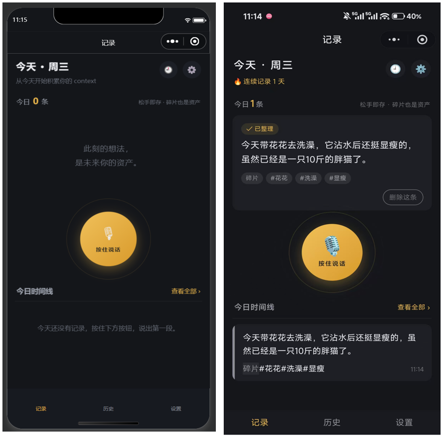
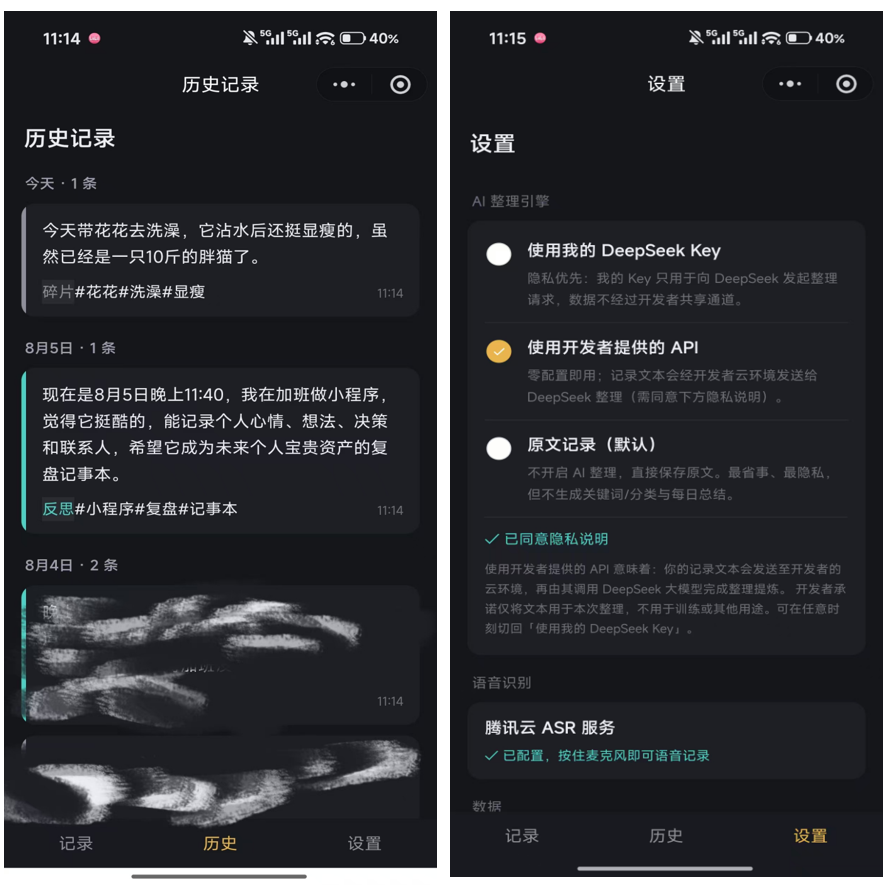

# Thought Clip

一个低摩擦的微信小程序记录工具：按住说话、松手即存，AI 帮忙整理成结构化笔记，长期积累成自己的个人 context 资产。

## 功能

- **贴纸记录**：按住麦克风说话松手即转文字，可继续追加语音段/文字段，点「完成贴纸」才保存；草稿本地持久化，误退不出丢内容；识别失败可降级为打字
- **声音灵感**：录完第一段语音后可一键「存为声音灵感」——保留原声、自动量化 48 档幅度图（不存文字），默认"10月8日 14:32"式标题可改；哼旋律没识别到内容时也可直接存为灵感；历史中独立样式展示，卡片内可直接回听（播放时幅度柱均衡器式起伏），详情页可重命名/导出音频（wav）
- **AI 整理**：DeepSeek 清理语气词、自动分类（决策 / 反思 / 碎片）、抽关键词——语音段逐段整理，确认贴纸时再整体总结一次；也可完全关闭 AI，直接存原文
- **录音实时波形**：录音中显示真实音量起伏；距 60 秒上限剩 8 秒时震动+倒计时预警，不怕话说一半被切断
- **暂存语音**：没有识别到内容时，录音可暂存 7 天（明确告知），期间可回听、重新识别、导出，到期自动删除
- **保留原声（可选）**：设置里开启后，成功识别的录音随记录一起长期保留，详情页可回听；关闭则识别完即删，只留文字
- **昨日复盘**：打开小程序时，若昨天有记录，顶部展示 AI 提炼的要点（原文记录模式下为统计摘要）；当天手动关掉后不再弹出
- **历史检索**：按天聚合浏览，支持全文搜索（整理文本/原文/关键词）、类型筛选，点记录上的 #关键词 直接搜索；可对比原始转写与整理后文本、编辑、删除
- **数据统计**：累计条数、连续天数、最长连续，以及近 15 周记录热力图，让"复利"看得见
- **导出备份**：一键导出全部记录为 Markdown 文件（含类型、关键词、原文），通过聊天发给自己
- **离线兜底**：断网时贴纸暂存本地（保留归属日期），网络恢复自动补传


## 界面展示





## 技术架构

原生微信小程序 + 微信云开发，四个云函数：

| 云函数 | 职责 |
|--------|------|
| `asr` | 腾讯云语音转文字；暂存语音的登记与删除 |
| `saveEntry` | DeepSeek 整理 + 落库（支持仅整理不落库模式） |
| `dailyReview` | 昨日复盘摘要 |
| `stats` | 连续天数/热力图统计、Markdown 导出、每日定时清理过期暂存语音 |

数据按 openid 隔离，存于你自己的云开发环境（`entries` / `users` / `voiceClips` 三个集合）。录音为 wav 16kHz 单声道：默认识别成功即删除云端音频；开启「保留原声」（`users.keepVoice`）后随记录保留（`entries.audioFileIDs`）；识别失败的暂存语音仅保留 7 天。AI Key 有三种模式：使用自己的 DeepSeek Key / 使用开发者提供的 API（需显式同意隐私说明）/ 原文记录（默认）。

## 快速上手

1. 打开小程序，首页即记录页
2. **按住屏幕中央的麦克风按钮说话，松手即转文字**，进入一张「贴纸」；也可以点麦克风下方的「打字」入口，从写一条开始
3. 贴纸内可以继续说（按住行内小麦克风）、继续写（输入框 + 添加），内容一段段追加进去；轻点某段可修改，点 ✕ 删除该段，长按可拖动排序
4. 点「**完成贴纸**」保存整条（AI 模式下保存时会整体再总结一次）；不想留就「丢弃」，完成后大麦克风按钮回归
5. 首次使用默认为「原文记录」模式（直接存原话）。想要 AI 帮忙整理，去「设置 → AI 整理引擎」选一种模式：
   - **使用我的 DeepSeek Key**：填入自己的 Key，语音段自动清理语气词、保存时自动分类、抽关键词
   - **使用开发者提供的 API**：点「同意隐私说明并启用」即生效，零配置
   - **原文记录**：不开启 AI，最省事、最隐私
6. 没识别到内容时会给你选择：**重新识别 / 暂存语音（保留 7 天）/ 放弃**；暂存的录音在首页「暂存语音」区可回听、重新识别、导出，7 天后自动删除
7. 打开小程序时，若昨天有记录，顶部会出现「昨日复盘」卡片（当天关掉后不再弹出）
8. 「历史」页顶部是累计统计和近 15 周热力图；支持全文搜索和类型筛选，点记录上的 #关键词 直接搜索
9. 「设置 → 导出全部记录」可把所有记录导出为 Markdown 文件发给自己的聊天，随时备份迁移
10. 断网时贴纸会先暂存本机（保留记录发生的日期），恢复网络后自动补传

> 单条录音最长 60 秒，剩最后 8 秒会震动提醒；识别是服务端转写，松手后约 1-3 秒出文字。

## 部署（开发者）

1. 注册微信小程序（个人主体免费）拿到 AppID，开通云开发并创建环境
2. 改 `project.config.json` 的 `appid`、`miniprogram/config.js` 的 `CLOUD_ENV`
3. 云开发控制台建集合 `entries`、`users`、`voiceClips`，权限均设为「仅创建者可读写」
4. 在开发者工具中对 `cloudfunctions/` 下的 `asr`、`saveEntry`、`dailyReview`、`stats` 分别右键「上传并部署：云端安装依赖」
5. 对 `stats` 右键 config.json（或函数目录）选择「上传触发器」，启用每日 04:00 的过期暂存语音清理
6. 给 `asr` 云函数配置环境变量 `TENCENT_SECRET_ID`、`TENCENT_SECRET_KEY`（腾讯云 API 密钥）；`saveEntry` / `dailyReview` 可选填 `DEEPSEEK_API_KEY`（开发者共享 Key）
7. 开发者工具「预览」扫码进入（**建议真机验证一次录音波形与播放**，开发者工具对录音帧回调的支持不完整）

> 从旧版本升级：重新部署 `asr` / `saveEntry` / `dailyReview`，新增部署 `stats`，并新建 `voiceClips` 集合。

## 说明

- 腾讯云 ASR 有免费额度（约 5000 次/月），日常使用基本不产生费用
- 昨日复盘为应用内展示，不做订阅消息推送（微信订阅模板标题不可自定义）

## 目录结构

```
thought-clip/
├── project.config.json          # AppID / miniprogramRoot / cloudfunctionRoot
├── miniprogram/
│   ├── app.js / app.json / app.wxss
│   ├── config.js                # 云环境 ID
│   ├── utils/                   # 日期工具 / 类型定义 / 离线队列 / 统计缓存
│   ├── components/              # mic-button / entry-card
│   └── pages/                   # index / history / detail / settings
└── cloudfunctions/
    ├── asr/                     # 语音转文字 + 暂存语音登记/删除
    ├── saveEntry/               # AI 整理（整条/仅整理）+ 落库
    ├── dailyReview/             # 昨日复盘
    └── stats/                   # 统计 / 导出 / 过期暂存语音定时清理（含触发器）
```

## 更新记录

### 2026-10-08 · 声音灵感

- **声音灵感专门记录**：面向音乐创作者的灵光一现——单段录音 + 标题（默认日期+时刻）+ 48 档量化幅度图，音频永久保留；不经 ASR、不经 AI
- 入口即大麦克风：录完第一段语音后贴纸上出现「♪ 存为声音灵感」；哼旋律触发「没识别到内容」时也可直接存为灵感；先打字或直接追加则按普通贴纸走
- 历史卡片独立样式（青色音符 + 幅度柱 + 时长），点击卡片内播放按钮直接回听；详情页支持重命名、回放、导出 wav、删除（删除连带清理音频）
- 计入连续天数与热力图；搜索可按标题命中；Markdown 导出包含声音灵感条目；离线时可入队补传
- 播放健壮性：云音频首次点播偶发解析失败时自动静默重试一次；过短录音（<1s，通常为误触）直接剪枝并提示「时间过短，多说一会吧」，不进识别链路
- 打磨：幅度图 16→48 档更细腻，播放时柱子均衡器式错峰起伏；全 app 播放/暂停图标统一 translate 居中（含光学修正）
- 技术要点：停录后解析本地 wav 量化幅度（data 块定位 + 分桶 RMS，每桶最多抽 200 样本）；贴纸首段语音始终先保留音频以备转换，未转换且未开「保留原声」时在确认/丢弃时自动清理

### 2026-09 · 体验打磨

- **贴纸输入动线统一**：贴纸出现后隐藏大麦克风，语音（行内小麦克风，带脉冲动画）与打字收进贴纸底部同一行，专注一条贴纸；录音时自动收起键盘
- **贴纸段落长按拖动排序**：实时换位 + 触感反馈，顺序随草稿保存
- **图标去 emoji 化**：头部时钟/设置滑杆、连续火苗、大小麦克风全部替换为自绘矢量（细线条风格，内嵌 SVG，任意缩放不糊）
- **「保留原声」开关重绘**：自绘深色适配 toggle，修复滑块与轨道错位
- **导出三级降级**：优先分享 .md 文件，部分机型不支持时自动改发 .txt，再退化为复制剪贴板；导出过程显示「导出中…」加载条
- 历史页热力图铺满卡片宽度，格子缩小、间隙加大，图例改为「少言无事 / 侃侃而谈」
- 首页底部与设置页新增数据隔离隐私说明；隐私声明、提示文案多处润色

### 2026-09 · 贴纸记录大改版

- **贴纸记录模型**：语音段 + 文字段混合追加为一条贴纸，语音段逐段 AI 整理（新增仅整理不落库模式），确认时整条再总结一次；草稿本地持久化，中途退出不丢
- **录音实时波形**：改用 wav 格式采集真实音量驱动波形（无帧机型自动降级动态波形）；距 60 秒上限剩 8 秒时震动 + 倒计时预警
- **暂存语音**：识别不到内容时可选 重新识别 / 暂存 7 天（可回听、重新识别、导出）/ 放弃，误关弹层自动暂存保底；到期由定时触发器自动清理
- **保留原声（可选）**：开启后成功识别的录音随记录长期保留（`entries.audioFileIDs`），详情页可回听；半路删段/丢贴纸会同步清理音频，不留孤儿文件
- **历史检索**：全文搜索（整理文本/原文/关键词）+ 类型筛选 + 点 #关键词 直接搜索
- **数据统计**：累计条数、连续天数、最长连续 + 近 15 周热力图（新增 stats 云函数，含导出与定时清理）
- **导出备份**：全部记录导出为 Markdown 文件（分块传输防超限）
- **健壮性修正**：记录归属日期由客户端传入（规避云函数容器时区坑）、离线补传带原始日期、网络恢复自动补传并提示、连续天数改聚合统计（修复单日多条导致的误断签）、识别失败改友好文案 + 短错误码、昨日复盘关闭后当天不再弹出

### 首版

- 按住说话、松手即存；DeepSeek AI 整理（自备 Key / 开发者 API / 原文记录三模式）；昨日复盘；历史按天浏览与编辑；离线草稿箱
